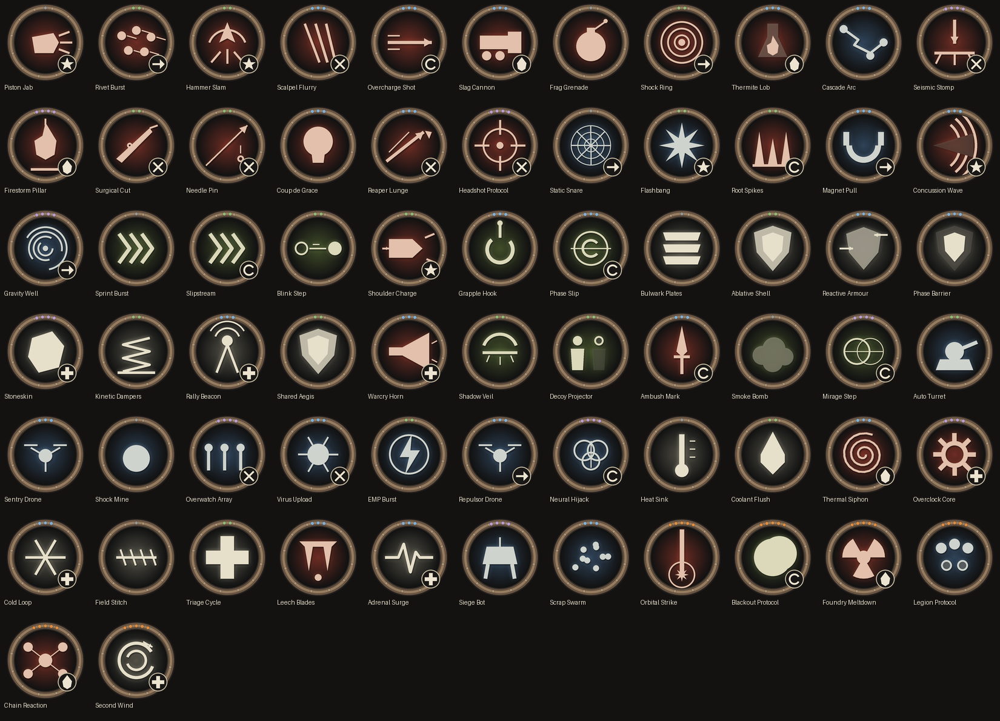

# Abilities: the power pass

Sean: "abilities are not useful at all, we should stress the use of them." This pass makes the 3 ability buttons the main way you fight; auto-attacks are filler that builds heat. All numbers live in `AB` and `ABILITIES` in `src/config.ts` (enemy HP retune in `BAL.g.hp`, `src/content/balance.ts`). Measured with `tools/balance` (`abilshare.mjs`); before/after table in `docs/BALANCE.md`.

## The loop
- **Auto-attacks are weaker (x0.45 damage) and hot (x2.4 heat).** A spammed ripper/pistol runs toward overheat (abilities offline, damage x0.5), so you want to spend heat through abilities.
- **Abilities cost less heat, cool down faster and hit harder.** Damage per heat: Sweep 8.0 vs auto 2.0 (test asserts >3x).
- **Heat-spend reward:** an ability cast with heat banked is CHARGED: +0.5% damage per heat point held (max +40%).
- **Combo chain:** a *different* ability within 3s of the last stacks +15% (max 3 stacks). Popup: `COMBO x2 +15%`.
- **Momentum:** killing with an ability refunds 0.8s on all cooldowns. A short hit-stop and screen kick sell the kill (off with Reduced FX).
- **Overclock:** Forced Cooling and Perfect Evade give +30% ability damage for 5s / 3s.

## Abilities (before -> after)
| Ability | Heat | Cooldown | Effect now |
|---|---|---|---|
| Powered Sweep | 24 -> 14 | 4 -> 3s | 34 -> 85 damage in a wide arc, shove, **staggers 0.7s**; "CLEAR xN" for 3+ hits |
| Blade Burst | 22 -> 14 | 5 -> 4s | 30 -> 90 damage through everything, **0.3s invulnerable** (was 0.2), 0.5s stagger |
| Disruption Pulse | 20 -> 14 | 6 -> 5s | 22 -> 55 damage, 1.2 -> 1.8s stun, radius 2.8 -> 3.2, **SHIELD-BREAK: 4x vs shields (min 45% of the shield)**, breaks stagger +50% damage |
| Enemy Control | 30 -> 20 | 12 -> 9s | turns one enemy for 8s; **mass stun: everything within 3.8 tiles is pulled in, stunned 1.6s, takes 45 overload damage and is HACKED (+40% damage taken for 6s)**. Elites/bosses/pylons resist: stun 2s/1s + hacked |
| Bracing | 14 -> 10 | 9 -> 7s | 60% -> **75% less damage** for 3.5s, **reflects 150% of what you take** to the attacker (cap 120), a charging attacker is **counter-stunned 2s**, shoves adjacent enemies, clears slows |
| Reposition | 12 -> 8 | 6 -> 4s | dash-strike 50 damage along the path + stagger, invulnerable 0.14 -> 0.32s. **Cast into a telegraph = PERFECT EVADE**: cooldown drops to 1.5s, -12 heat, +30% abilities for 3s |
| Cloak | 20 -> 12 | 10 -> 8s | next hit is an **AMBUSH crit**: autos x3 (was x2), abilities x2.5, and the damage is credited to Cloak |
| Forced Cooling | 0 | 10 -> 8s | vent 70 heat, weapons offline 2 -> 1.2s, **OVERCLOCK** (+30% abilities 5s) and other cooldowns -2s |
| Team Revival | 18 -> 16 | 6 -> 8s | was inactive solo; now **Rally**: heal 30% HP + 60-damage shockwave with 1.2s stun (still revives a party member) |
| Self-Defib | passive | | unchanged; now has its own arc/glow effect |

## Enemies that need abilities
- **Shielded mobs and boss shields:** autos do 35% to a shield, abilities 150%, Pulse 400%. Breaking a shield staggers (+50% damage). "Shield: use Pulse".
- **Healers/support** (Mender, Relay Node...): Control stuns and hacks them (stunned casters cannot cast). "Healer: use Control".
- **Chargers** (Scrap Ram, Shift Stalker, Rebar Crusher): Brace through the charge = counter-stun; Reposition dodges it. "Charger: Brace".
- **Telegraphed AoE** (casters, bosses): Reposition into the telegraph is a perfect evade.
- **Summoners/swarms:** Sweep clears adds and staggers the pack.
- **Elite affixes:** regenerating stops healing for 3s after any ability hit and heals 4%/s otherwise (burst it); vampiric/hasted -> stun with Control; volatile -> stun and kill at range; shielded -> Pulse.
- Control cannot turn boss pylons any more (a bot found that it softlocked the Overseer).

## Guidance in game
- Counter icon over every alerted enemy (small medallion of the ability that answers it, with the hotkey; bright when ready, dim on cooldown, faint if not equipped).
- First-time toasts per trait ("Shield: use Pulse [E]", "Healer: use Control [R]") stored in `localStorage.wv_abhints`.
- Low-use nudge: 16s of combat with no cast and an ability ready: "Abilities are ready: Sweep [Q] hits far harder than auto-attacks." (once per 40s)
- Tooltips list the numbers (damage, stun, reflect, shield multiplier, cooldown, heat).

## Visual effects (src/vfx.ts, src/vfxdraw.ts)
Pooled particle system (700 / 260 / 100 particles on High / Medium / Low, 36 with Reduced FX), iso world space, additive blends, per-event emitters. The sim only pushes events (`g.vfx('sweep.cast', ...)`).
| Ability | Cast | Impact |
|---|---|---|
| Sweep | arc streak fan + shockwave ring + debris at the tips | sparks + debris per target, CLEAR popup |
| Blade Burst | afterimage ghosts and streaks along the lunge | X-slash flurry + sparks + local bloom |
| Pulse | double expanding ring, rune glyph, radial sparks | shard shatter on shield break, "SHIELD BREAK" |
| Control | contracting pull rings, tether arc to the target, rune | rings + stun stars on each pulled enemy |
| Brace | hex barrier burst; persistent rotating hex shell | hit ripple at the impact side, reflect arc + flash |
| Reposition | ghost afterimages, streak, footprint dust | spark burst; PERFECT EVADE ring + bloom |
| Cloak | rising shimmer motes, ghost | AMBUSH slash trio + ring + bloom |
| Forced Cooling | steam puffs + frost shards | OVERCLOCK ring around the player while active |
| Revive / Defib | electric arcs, ring, glow | |
Status icons over enemies: stunned (orbiting stars), hacked (diamond with countdown), staggered/shield broken (cracked shield), controlled (dashed tether + hex ring). Aim previews are colour-matched to the ability type with the true areas (Sweep arc, Burst line, Pulse radius with shielded targets highlighted gold, Control pull radius, Reposition path with a green ring when it would be a perfect evade).
Photosensitivity: local blooms go through `flashguard.ts` (max 3/s, alpha capped), there are no full-screen flashes, and Reduced FX removes blooms, additive glows, hit-stop, shake and most particles.

## Tests
- `tests/ability_e2e.mjs`: every ability by pointer, key and touch, plus sim-level asserts for each synergy (stagger, shield-break, mass stun + hack, reflect, counter-stun, ambush, perfect evade, overclock, combo, kill refund, rally, damage per heat, first-shield hint).
- `tests/ability_vfx.mjs`: every ability spawns cast/impact effects, caps per tier, Reduced FX has no blooms, flash guard, defib effect. `SHOTS=dir` writes frame strips; `tools/ability_vfx_sheet.mjs` builds `docs/art/ability_vfx/contact_sheet.png` (before/after rows).

<!-- AUGMENT-ABILITIES -->
# Augment abilities (data-driven portfolio) (68)

_Generated by `node tools/abilities/gen_doc.mjs` from `src/abilities/*`. Do not edit the tables by hand._

Augments (hardware) grant abilities; the three ability buttons (Q/E/R) bind to any ability your installed hardware grants. This pass adds **68 data-driven abilities** on top of the 10 legacy ones, **78 generated ability-bearing augments**, an acquisition curve (common early, rare genuinely rare), a codex and a Q/E/R assignment UI.

## Files

| File | Purpose |
|---|---|
| `src/abilities/types.ts` | data types: roles, shapes, tags, effect primitives |
| `src/abilities/data.ts` | the 68 ability definitions (data only) |
| `src/abilities/engine.ts` | executes primitives in the sim (cast, per-frame tick, incoming/outgoing damage hooks) |
| `src/abilities/hw.ts` | generated augments, acquisition knobs (`ABILITY_ACQ`), balance knob (`ABILITY_BAL`), chip modifiers, loot picking |
| `src/abilities/vfx.ts`, `src/abx_render.ts` | default colour-coded VFX per primitive + persistent status/deployable drawing; `registerAbilityVfx(id, fn)` for bespoke art |
| `src/abilities/ui_ext.ts` | locker ability slots, tooltips, codex |
| `tools/abilities/make_icons.py` | procedural medallion icons (`public/abilities/<id>.webp`), contact sheet `docs/abilities_icons.png` |
| `tests/abilities_data.mjs`, `abilities_e2e.mjs`, `ability_acq.mjs`, `ability_balance.mjs` | tests (`npm run test:abilities`) |

## Design

### Roles x manufacturer x body slot

- **Roles (13):** Damage burst (6), Area damage (6), Execute (5), Crowd control (6), Mobility (6), Defence (6), Support (3), Stealth (5), Hacking / tech (8), Heat control (5), Sustain (4), Summons (2), Ultimate (6).
- **Manufacturer identity:** *Heavy Industrial* (21): big, loud, heat-hungry (area, knockback, burning, armour, summoned heavy bots). *Precision Surgical* (23): marks, executes, cloaks, teleports, hacking control; cooldown-gated rather than heat-gated. *Mass Market* (24): cheap utility, grenades, turrets/drones, heat sinks, healing; plentiful and available early. An augment only grants abilities from its own manufacturer.
- **Body-slot identity:** arms/hands = damage and crowd control; legs/feet = mobility; torso = defence, sustain, support; brain = hacking, heat, summons; face = stealth, execution. Each ability lists the slot groups that may carry it; the generator only places it on matching slots (tested).
- **Rarity gating:** an augment's rarity is >= its abilities' rarity; orange abilities are ultimate-style only (cd >= 30 s), carried by orange hardware (level >= 27).

### Effect primitives

Abilities are lists of primitives, composed by the engine (`engine.ts`). Damage `k` is a coefficient: damage = 30 x k x scaling stat x (1 + chip damage mod) x overheat mult.

`damage cone line circle chain projectile dash teleport pull push stun slow root mark expose burn tether control strip lose shield mitigate reflect heal cloak cdr vent ventHit buff invuln shoot summon(turret|drone|decoy|bot) aura trap delayed` plus **toggles** (heat per second while on, with passive mitigation/damage/speed/venting).

Bosses resist crowd control (stun x0.35, root x0.4, slow halved, no pull/push, no control); elites stun x0.6 and cannot be controlled.

### Synergy tags

Enemy states: **Marked** (+15% damage taken), **Exposed** (+20%), **Burning**, **Rooted**, **Slowed**, **Staggered** (stunned), **Tethered** (damage echoes 50%). Player states: **Cloaked**, **Shielded**, **Overheated**, **Hasted**, **Charged** (damage buff). Abilities declare what they apply (`gives`) and what they exploit (`uses`, `bonus` multipliers that can consume the tag, `exec` thresholds, kill cooldown refunds). Example: Needle Pin marks, Surgical Cut x1.5 on Marked (consumes), Headshot Protocol x2 on Marked and refunds 5 s on kill.

### Chips change abilities

Chips map to ability modifiers automatically (`CHIP_AB_MODS` in `hw.ts`; `chipsFor(ability)` lists which chips matter, shown in the tooltip): cooldown reduction (Speed/Fine-edge), heat cost (Coolant/Quench), cone arc (Cut-wide), length/range (Blade pattern), heal (Sustain), shield and mitigation (Ablative/Plating), cloak seconds (Cloak duration), control duration (Control duration/Grid link), dash distance (Stride/Servo), buff and summon duration (Grid link), damage (Power/Overdrive/Fine-edge).

### Caps, conflicts, binding

Only three abilities are bound (Q/E/R). Duplicates collapse; `save.abPick` stores your choice and falls back to slot priority for gaps or abilities you no longer own. Picks that no installed hardware grants are refused. Locker: cycle buttons per slot (draft aware) and a list of granted-but-unbound abilities with hover details; in play **Shift+Q/E/R** cycles the button through your granted abilities.

## Acquisition curve

Goal: getting an ability augment is common at first; rare abilities are rare.

- **Portfolio shape:** 28 of 68 abilities (41%) are common (grey/green), 24 blue (mid-game), 10 purple and 6 orange (signature ultimates, the strongest build-defining effects).
- **Common:** drops from ordinary enemies, sold by the vendor at the normal low grey/green prices (the vendor lists every grey/green/blue augment you are level for), the **tutorial hands you one**, and the **pity timer** forces one.
- **Uncommon (blue):** elites and bosses mostly, vendor (300c), level 14+.
- **Rare (purple):** elites/bosses only, low weight, level 20+ and **manufacturer reputation rank >= 1**.
- **Signature (orange):** **boss drops only**, low weight, level 27+, reputation rank >= 2, and the dungeon's item-level cap (Foundry and above).
- **Respects `DROP_RATE_SCALE`:** conversion *replaces* a rolled item/chip/patch; it never adds rolls, so the volume cut stays. Ability augments simply become a larger share of early drops.
- **Pity timer:** the very first item roll of a new save, and the first roll of any run following 1 finished run(s) without an ability-bearing pickup, is forced to a *common* augment (prefers abilities you have not discovered). Counters live in `save.abAcq`.
- **Discovery:** the first time hardware granting an ability reaches storage or your pack, a toast announces *New ability discovered: name (rarity)* and it is recorded in the **Abilities codex** (locker > Abilities codex) listing discovered and undiscovered abilities by rarity with drop hints.

### Knobs (`ABILITY_ACQ` in `src/abilities/hw.ts`)

| knob | value |
|---|---|
| `scale` (global multiplier on conversion chances) | 1 |
| `convert` (chance a roll becomes an ability augment) | ordinary 0.22, elite 0.35, boss 0.5 |
| `newBoost` (weight on undiscovered abilities) | x3 |
| `rankGate` | grey 0, green 0, blue 0, purple 1, orange 2 |
| `orangeBossOnly` | true |
| `pityRuns` / `firstRunGuarantee` | 1 / true |

Drop weight per ability rarity (relative weights within a converted roll, before level/rank/tier-cap eligibility):

| source | grey | green | blue | purple | orange |
|---|---|---|---|---|---|
| ordinary | 44 | 42 | 12 | 2 | 0 |
| elite | 8 | 26 | 52 | 13 | 1 |
| boss | 0 | 12 | 46 | 32 | 10 |

### Measured distribution (`tests/ability_acq.mjs`, real loot code, seeded)

- **Median runs to first new ability on a fresh save: 1** (worst of 25 fresh saves: 2).

| stage | runs | gear drops/run | ability augments/run | share of gear | grey | green | blue | purple | orange |
|---|---|---|---|---|---|---|---|---|---|
| early (L12, rep 0, Annex) | 50 | 5.2 | 2.3 | 45% | 10% | 68% | 22% | 0% | 0% |
| mid (L24, rank 1, Foundry) | 100 | 6.5 | 3.2 | 49% | 6% | 15% | 63% | 16% | 0% |
| late (L40, rank 3, tier IV) | 100 | 9.3 | 3.8 | 41% | 8% | 17% | 56% | 16% | 3% |

(Counts include the legacy ability-bearing hardware. Each run kills everything and rolls the boss; the harness freezes XP so a stage keeps its level.)

## Balance

- Bounds enforced by `tests/abilities_data.mjs`: heat <= 46, cooldown 2-60 s, damage coefficient per second <= 1.1 (ultimates/orange excepted), heat/s <= 6, toggle drain <= 8/s, mean power rises grey < green < blue < purple < orange, Heavy Industrial is the most heat-hungry.
- `ABILITY_BAL` (`hw.ts`) scales all augment-ability damage and heat in one place.
- Harness kits: `node tools/balance/run.mjs --kits abmid,abpurple` equip the ability augments at mid/purple rarity ceilings. Legacy kits exclude `ab_*` hardware so existing baselines are unchanged. `tests/ability_balance.mjs` runs both against the legacy kits.
- **Finding:** at Annex L16 the ability kit (blue ability augments, bot casting them) clears in ~91 s with 0 deaths versus the legacy mid kit's ~266 s with ~3.5 deaths, and at Foundry L32 ~82 s vs ~108 s. Abilities are now clearly useful (the point), but they push clears above the 70-90% par target; if that is too strong, lower `ABILITY_BAL.dmg` or heat-efficiency, or raise enemy HP, after the parallel legacy-ability power pass lands so both are tuned together.

## Implemented vs placeholder

- **Implemented in the sim and verified one by one** (`tests/abilities_e2e.mjs`, table driven: casts every ability against dummies and asserts each primitive's observable effect): all 68.
- **VFX:** every ability has a colour-coded fallback (ring/slash/line/burst by type and primitive) plus persistent drawing for statuses, shields, toggles, projectiles, turrets/drones/bots/decoys, traps, auras, delayed strikes. No ability has bespoke art yet (hook ready: `registerAbilityVfx`).
- **Icons:** all 68 are procedurally generated medallions in the same rim style (type-coloured disc, glyph, badge for a secondary effect, rarity pips on the rim). They are placeholders in the sense of being vector glyphs rather than illustrations.
- **Audio:** abilities reuse existing generic SFX; no per-ability sounds.
- **Not done:** touch quick-swap (use the locker; Shift+Q/E/R is keyboard only); ally targeting (Rally Beacon and Shared Aegis are self-only in this solo game); Neural Hijack on elites stuns instead of converting.

## Ability table

| ability | role | mfr | rarity | slots | aim | heat | cd | effect | tags (applies / uses) | augments |
|---|---|---|---|---|---|---|---|---|---|---|
| **Frag Grenade** | Area damage | Mass Market | grey | arm/hand/torso | ground | 9 | 5s | After 0.5s:, 33 dmg in 2.5 tiles. | - | KV Frag Grenade Arm (L); KV Frag Grenade Duo Hand (R) |
| **Piston Jab** | Damage burst | Heavy Industrial | grey | arm/hand | cone | 9 | 3.5s | 45 dmg in a 50° cone, stuns 0.4s. | Staggered | HB Piston Jab Arm (L); HB Piston Jab Hand (L) |
| **Static Snare** | Crowd control | Mass Market | grey | arm/hand/brain | ground | 8 | 6s | 9 dmg in 2.5 tiles, slows 55% for 3.5s. | Slowed | KV Static Snare Duo Arm (R); KV Static Snare Hand (L) |
| **Bulwark Plates** | Defence | Heavy Industrial | grey | torso/leg | self | 7 | 9s | 45% less damage 3s. | - | HB Bulwark Plates Torso; HB Bulwark Plates Leg (L) |
| **Heat Sink** | Heat control | Mass Market | grey | brain/torso | self | 0 | 8s | Vents 35 heat. | - | KV Heat Sink Core; KV Heat Sink Torso |
| **Sprint Burst** | Mobility | Mass Market | grey | leg/foot | self | 6 | 8s | +40% speed 3s. | Hasted | KV Sprint Burst Leg (R); KV Sprint Burst Foot (R) |
| **Smoke Bomb** | Stealth | Mass Market | grey | torso/arm/face | ground | 8 | 10s | 3-tile field for 5s. | - | KV Smoke Bomb Duo Torso; KV Smoke Bomb Arm (R) |
| **Field Stitch** | Sustain | Mass Market | grey | torso/arm | self | 6 | 12s | Heals 22% HP over 4s. | - | KV Smoke Bomb Duo Torso; KV Field Stitch Arm (L) |
| **Shock Mine** | Hacking / tech | Mass Market | grey | arm/hand/leg | ground | 8 | 6s | Lays a trap. | Staggered | KV Frag Grenade Duo Hand (R); KV Static Snare Duo Arm (R) |
| **Shock Ring** | Area damage | Mass Market | green | arm/torso/brain | self | 11 | 5s | 27 dmg in 3.5 tiles, slows 40% for 2.5s. | Slowed | KV Rivet Burst Duo Arm (R); KV Shock Ring Duo Torso |
| **Hammer Slam** | Damage burst | Heavy Industrial | green | arm/hand | self | 14 | 5s | 51 dmg in 2.4 tiles, stuns 0.6s. | Staggered | HB Hammer Slam Duo Arm (L); HB Hammer Slam Hand (L) |
| **Rivet Burst** | Damage burst | Mass Market | green | arm/hand | cone | 10 | 4s | 48 dmg in a 44° cone, slows 25% for 1.5s. | Slowed | KV Rivet Burst Duo Arm (R); KV Rivet Burst Hand (R) |
| **Flashbang** | Crowd control | Mass Market | green | face/torso | self | 11 | 8s | 9 dmg in 4 tiles, stuns 0.9s, enemies lose track of you. | Staggered | KV Shock Ring Duo Torso; KV Flashbang Duo Visor |
| **Root Spikes** | Crowd control | Heavy Industrial | green | arm/leg | line | 12 | 7s | 18 dmg along a 6-tile line, roots 2.2s. | Rooted | HB Hammer Slam Duo Arm (L); HB Root Spikes Leg (R) |
| **Ablative Shell** | Defence | Heavy Industrial | green | torso | self | 10 | 10s | 30% max HP shield 6s. | Shielded | HB Ablative Shell Torso |
| **Kinetic Dampers** | Defence | Precision Surgical | green | leg/torso | self | 9 | 9s | 35% less damage 2.5s, +15% speed 2.5s. | Hasted | AS Kinetic Dampers Leg (L); AS Kinetic Dampers Duo Torso |
| **Needle Pin** | Execute | Precision Surgical | green | hand/arm/face | lockon | 7 | 5s | Fires a bolt, → hits for 36, Marks 8s (+15% damage taken). | Marked | AS Needle Pin Hand (R); AS Needle Pin Arm (R) |
| **Surgical Cut** | Execute | Precision Surgical | green | hand/arm | lockon | 8 | 4s | Hits for 51, x1.5 vs Marked (consumes). | uses Marked | AS Surgical Cut Hand (L); AS Surgical Cut Arm (L) |
| **Coolant Flush** | Heat control | Precision Surgical | green | brain/torso | self | 0 | 10s | Vents 50 heat, other cooldowns -1.2s. | - | AS Coolant Flush Torso; AS Coolant Flush Core |
| **Blink Step** | Mobility | Precision Surgical | green | foot/leg | ground | 12 | 7s | Teleports to the aimed point (up to 5.5 tiles). | - | AS Blink Step Foot (L); AS Blink Step Leg (R) |
| **Shoulder Charge** | Mobility | Heavy Industrial | green | leg/arm | line | 13 | 7s | Dashes 4.5 tiles (brief invulnerability) for 30 dmg, stuns 0.6s. | Staggered | HB Shoulder Charge Leg (L); HB Shoulder Charge Arm (L) |
| **Slipstream** | Mobility | Mass Market | green | foot/leg | line | 8 | 6s | Dashes 4.2 tiles (brief invulnerability), +25% speed 3s. | Hasted | KV Slipstream Foot (R); KV Slipstream Leg (L) |
| **Decoy Projector** | Stealth | Mass Market | green | face/brain | ground | 10 | 11s | Deploys a decoy (5s). | - | KV Flashbang Duo Visor; KV Shared Aegis Duo Core |
| **Shadow Veil** | Stealth | Precision Surgical | green | face/torso | self | 11 | 10s | Cloaks you for 4s (enemies lose track). | Cloaked | AS Kinetic Dampers Duo Torso; AS Shadow Veil Visor |
| **Shared Aegis** | Support | Mass Market | green | torso/brain | self | 12 | 12s | 20% max HP shield 6s. | Shielded | KV Shared Aegis Torso; KV Shared Aegis Duo Core |
| **Triage Cycle** | Sustain | Precision Surgical | green | torso/brain | self | 10 | 16s | Heals 28% HP. | - | AS Triage Cycle Torso; AS Triage Cycle Core |
| **Auto Turret** | Hacking / tech | Mass Market | green | arm/brain/torso | ground | 14 | 12s | Deploys a turret (12s). | - | KV Auto Turret Core; KV Auto Turret Arm (L) |
| **EMP Burst** | Hacking / tech | Mass Market | green | brain/face/torso | self | 13 | 8s | 18 dmg in 4 tiles, strips shields, stuns 1.1s. | Staggered | KV EMP Burst Core; KV EMP Burst Visor |
| **Cascade Arc** | Area damage | Mass Market | blue | arm/brain/hand | lockon | 14 | 5s | Chains to 4 enemies. | - | KV Cascade Arc Duo Arm (R) |
| **Thermite Lob** | Area damage | Heavy Industrial | blue | arm/hand | ground | 22 | 6s | After 0.6s:, 39 dmg in 2.8 tiles, burns 4s. | Burning | HB Thermite Lob Duo Arm (L) |
| **Overcharge Shot** | Damage burst | Precision Surgical | blue | hand/arm | line | 12 | 5s | Fires a bolt (pierces 3), → hits for 60. | - | AS Overcharge Shot Hand (R) |
| **Scalpel Flurry** | Damage burst | Precision Surgical | blue | hand/arm | cone | 10 | 5s | 21 dmg in a 70° cone, 21 dmg in a 70° cone, 21 dmg in a 70° cone, Marks 6s (+15% damage taken). | Marked | AS Scalpel Flurry Duo Hand (L) |
| **Slag Cannon** | Damage burst | Heavy Industrial | blue | arm | line | 20 | 6s | Fires a bolt, → hits for 45, burns 4s. | Burning | HB Slag Cannon Arm (R) |
| **Concussion Wave** | Crowd control | Heavy Industrial | blue | arm/torso | cone | 18 | 7s | 27 dmg in a 100° cone, knocks back, stuns 1s. | Staggered | HB Thermite Lob Duo Arm (L) |
| **Magnet Pull** | Crowd control | Mass Market | blue | arm/brain/hand | ground | 16 | 8s | 12 dmg in 4 tiles, pulls in, slows 40% for 2s. | Slowed | KV Cascade Arc Duo Arm (R) |
| **Phase Barrier** | Defence | Precision Surgical | blue | torso/brain | self | 14 | 12s | 25% max HP shield 5s, 0.8s invulnerable. | Shielded | AS Phase Barrier Torso |
| **Reactive Armour** | Defence | Heavy Industrial | blue | torso | self | 18 | 11s | 30% less damage 4s, reflects 100% of damage. | - | HB Reactive Armour Duo Torso |
| **Coup de Grace** | Execute | Precision Surgical | blue | hand/arm/face | lockon | 12 | 8s | Hits for 48, x2.6 below 30% HP, kill refunds 3s cooldown. | - | AS Scalpel Flurry Duo Hand (L) |
| **Reaper Lunge** | Execute | Precision Surgical | blue | leg/arm | lockon | 14 | 7s | Dashes 7 tiles (brief invulnerability), hits for 51, x1.3 vs Marked, x2 below 25% HP. | uses Marked | AS Reaper Lunge Leg (L) |
| **Cold Loop** | Heat control | Precision Surgical | blue | brain/torso | toggle | 3 | 3s | Toggle:  vents 6/s, -15% speed. | - | AS Virus Upload Duo Core |
| **Thermal Siphon** | Heat control | Heavy Industrial | blue | torso/arm/brain | self | 10 | 7s | 24 dmg in 3 tiles, vents 7 heat per enemy hit (max 35). | - | HB Thermal Siphon Torso |
| **Grapple Hook** | Mobility | Mass Market | blue | arm/leg/hand | lockon | 12 | 8s | Dashes 9 tiles (brief invulnerability), hits for 24, stuns 0.5s. | Staggered | KV Grapple Hook Arm (R) |
| **Phase Slip** | Mobility | Precision Surgical | blue | leg/foot | line | 16 | 9s | Dashes 4.6 tiles (brief invulnerability), cloaks you for 1.8s (enemies lose track). | Cloaked | AS Phase Slip Leg (R) |
| **Ambush Mark** | Stealth | Precision Surgical | blue | face/torso | self | 13 | 11s | Cloaks you for 2.5s (enemies lose track), next hit x2 (ambush). | Cloaked | AS Ambush Mark Visor |
| **Scrap Swarm** | Summons | Mass Market | blue | arm/torso/brain | self | 18 | 13s | Deploys a drone (9s). | - | KV Scrap Swarm Arm (L) |
| **Rally Beacon** | Support | Mass Market | blue | torso/brain | self | 14 | 14s | 4.5-tile field for 7s. | Charged | KV Rally Beacon Duo Torso |
| **Warcry Horn** | Support | Heavy Industrial | blue | torso/face | self | 16 | 13s | +30% damage 6s, 6 dmg in 4 tiles, slows 30% for 2s. | Charged | HB Reactive Armour Duo Torso |
| **Adrenal Surge** | Sustain | Mass Market | blue | torso/leg | self | 12 | 14s | Heals 25% HP over 5s, +20% damage 5s. | Charged | KV Rally Beacon Duo Torso |
| **Leech Blades** | Sustain | Heavy Industrial | blue | arm/hand/torso | self | 14 | 12s | 18% lifesteal 7s. | - | HB Leech Blades Arm (L) |
| **Repulsor Drone** | Hacking / tech | Heavy Industrial | blue | brain/arm/torso | self | 18 | 13s | Deploys a drone (9s). | - | HB Repulsor Drone Core |
| **Sentry Drone** | Hacking / tech | Mass Market | blue | brain/torso/arm | self | 16 | 14s | Deploys a drone (11s). | - | KV Sentry Drone Core |
| **Virus Upload** | Hacking / tech | Precision Surgical | blue | brain/face | lockon | 15 | 9s | Burns 5s, Exposes 6s (+20% damage taken), Marks 6s (+15% damage taken). | Exposed, Marked, Burning | AS Virus Upload Duo Core |
| **Firestorm Pillar** | Area damage | Heavy Industrial | purple | arm/torso/brain | ground | 32 | 10s | 3-tile field for 4.5s. | Burning | HB Firestorm Pillar Arm (L) |
| **Seismic Stomp** | Area damage | Heavy Industrial | purple | leg/torso | self | 34 | 8s | 63 dmg in 4.6 tiles, stuns 1.1s, Exposes 5s (+20% damage taken). | Staggered, Exposed | HB Seismic Stomp Leg (R) |
| **Gravity Well** | Crowd control | Precision Surgical | purple | brain/face | ground | 26 | 12s | 4-tile field for 4s. | Slowed | AS Gravity Well Duo Core |
| **Stoneskin** | Defence | Heavy Industrial | purple | torso | toggle | 6 | 2s | Toggle: +5.5 heat/s, 30% less damage, -15% speed. | - | HB Stoneskin Torso |
| **Headshot Protocol** | Execute | Precision Surgical | purple | face/hand/arm | lockon | 18 | 10s | Hits for 102, x2 vs Marked (consumes), x2 below 35% HP, kill refunds 5s cooldown. | uses Marked | AS Headshot Protocol Duo Visor |
| **Overclock Core** | Heat control | Heavy Industrial | purple | brain/torso | toggle | 4 | 3s | Toggle: +6 heat/s, +30% damage. | uses Overheated | HB Overclock Core Core |
| **Mirage Step** | Stealth | Precision Surgical | purple | face/leg/brain | ground | 20 | 12s | Teleports to the aimed point (up to 6.5 tiles), cloaks you for 3s (enemies lose track), deploys a decoy (4s). | Cloaked | AS Headshot Protocol Duo Visor |
| **Siege Bot** | Summons | Heavy Industrial | purple | arm/torso/brain | ground | 30 | 16s | Deploys a bot (14s). | Slowed | HB Siege Bot Arm (R) |
| **Neural Hijack** | Hacking / tech | Precision Surgical | purple | brain/face | lockon | 28 | 16s | Turns an enemy 7s, Tethers (damage echoes). | Tethered | AS Neural Hijack Core |
| **Overwatch Array** | Hacking / tech | Precision Surgical | purple | brain/arm | ground | 26 | 14s | Deploys a turret (14s). | uses Marked | AS Gravity Well Duo Core |
| **Blackout Protocol** | Ultimate | Precision Surgical | orange | face/brain/torso | self | 35 | 45s | Enemies lose track of you, cloaks you for 6s (enemies lose track), next hit x2.4 (ambush). | Cloaked | AS Blackout Protocol Visor |
| **Chain Reaction** | Ultimate | Heavy Industrial | orange | arm/brain | self | 40 | 35s | Everything within 9 tiles, Marks 4s (+15% damage taken), Tethers (damage echoes), after 1.6s:, 72 dmg in 9 tiles, burns 3s. | Marked, Tethered, Burning | HB Chain Reaction Arm (R) |
| **Foundry Meltdown** | Ultimate | Heavy Industrial | orange | torso/arm | self | 45 | 45s | 78 dmg in 4.4 tiles, burns 5s, 40% max HP shield 8s, +50% damage 8s. | Burning, Shielded, Charged | HB Foundry Meltdown Torso |
| **Legion Protocol** | Ultimate | Mass Market | orange | brain/torso | ground | 40 | 40s | Deploys a turret (14s), deploys a turret (14s), deploys a drone (14s), deploys a drone (14s). | - | KV Legion Protocol Core |
| **Orbital Strike** | Ultimate | Precision Surgical | orange | face/brain | ground | 45 | 40s | After 1.3s:, 195 dmg in 3.6 tiles, stuns 2s, Marks 8s (+15% damage taken). | Staggered, Marked | AS Orbital Strike Visor |
| **Second Wind** | Ultimate | Mass Market | orange | torso/brain | self | 0 | 60s | Heals 60% HP, 30% max HP shield 8s, resets other cooldowns, vents 100 heat. | Shielded | KV Second Wind Torso |

## Icon sheet

`docs/abilities_icons.png` (regenerate: `python3 tools/abilities/make_icons.py --sheet docs/abilities_icons.png`).

## Heat and cooldowns (balance pass)

Heat is the primary limiter on sustained ability use; cooldown is the secondary limiter (bursts and ultimates). Tunables and formulas: `src/heat.ts`. Full before/after numbers: `docs/BALANCE.md` "Heat pass".

- **Costs:** every ability's heat in the tables above is the *authored* value. In game it is multiplied by 1.8 for core abilities and 1.2 for augment abilities (`HEAT.abilityMul`, `HEAT.extMul`) and cooldowns by 0.6 (`HEAT.cdMul`), applied once in `src/config.ts`; damage per cast is x1.4 (`HEAT.powerMul`) so fewer casts still carry the fight. In-game tooltips show the real cost after gear.
- **Heat reduction is capped:** chips (`coolant`, `quench`) and other `heat` modifiers have diminishing returns and never remove more than 30% of a cast's heat. COOL on gear saturates at x1.4 effective (dissipation max 8.4/s). Cooldown reduction caps at 30%.
- **The trade:** every point of effective heat reduction costs ability damage (up to about 12% for the reduction cap plus 12% at the COOL cap), so a heat spec sustains rather than spams.
- **Heat-role augments** (`vent`, `ventHit` primitives, toggles that vent) are scaled with the same factor so Thermal Siphon style abilities keep their value; a toggle's heat per second is also x1.8, so leaving one running is a real cost.
- **Overheat:** 2.5 s minimum lockout, back online at 50 heat, dissipation x0.8, +25% damage taken, autos at half rate. Abilities cannot be cast, toggles switch off.
- **Vent (`V` or tap the heat bar):** the manual heat-management skill. See the table in `docs/BALANCE.md`.
- **Synergies:** `Charged` (spending stored heat for damage) still reads raw heat, so playing hot is rewarded as long as you do not tip over; `Overheated` tag abilities still work as before.
